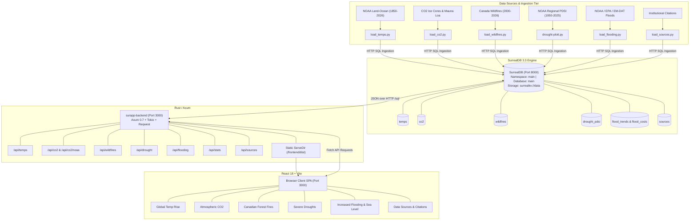

# Planetary Climate Observatory – System Architecture & Component Specification Report

## 1. Executive Summary & Architecture Overview

The **Planetary Climate Observatory** is an end-to-end, full-stack scientific visualization platform designed to aggregate, store, analyze, and interactively present multi-decadal planetary climate indicators and clean energy transition benchmarks.

The application follows a modern **four-tier decoupled architecture**:
1. **Raw Scientific Ingestion Tier (Python ETL Pipelines)**: Ingests raw data files from NOAA, EPA, EM-DAT, and Canadian CFS/CWFIS into normalized structures.
2. **Persistence Tier (SurrealDB 3.3 Multi-Model Database)**: High-performance on-disk storage powered by SurrealKV/RocksDB, handling relational and timeseries climate records.
3. **Application & API Gateway Tier (Rust + Axum + Tokio)**: An asynchronous REST server providing sub-millisecond query routing, filtering, statistical rollups, and static SPA serving.
4. **Presentation & Analytics Tier (React 18 + Vite + Chart.js)**: A dark-glassmorphism single-page application (SPA) featuring interactive charts, KPI callouts, historical milestones, and CSV export capabilities.



---

## 2. Component Breakdown & Functional Responsibilities

### 2.1 Raw Data Sources & Ingestion Layer (`/input/` & Python Loaders)

The application ingests historical datasets from authoritative institutions. Rather than coupling the web server directly to fragile text parsers, dedicated Python ingestion modules validate, transform, and load data into SurrealDB via HTTP POST commands to `http://127.0.0.1:8000/sql`.

| Ingestion Script | Input Source File | Target SurrealDB Table | Transformations Performed |
| :--- | :--- | :--- | :--- |
| `load_temps.py` | `input/NOAA world temps/aravg.mon...asc` | `temps` | Parses 177 years (1850–2026) of NOAA annual land-ocean temperature anomalies and 95% uncertainty ranges (`lower_bound`, `upper_bound`). |
| `load_co2.py` | `input/CO2/co2-concentration-long-term.csv` & `co2_annmean_mlo.txt` | `co2` | Combines 10,000-year Antarctic EPICA/Law Dome ice core records (-10,000 BCE to modern) with continuous in-situ NOAA Mauna Loa ppm measurements. |
| `load_wildfires.py` | `input/Fires/canada-wildfires.csv` | `wildfires` | Normalizes 27 years of Canadian CFS/CWFIS wildfire totals, converting hectares to million acres and calculating decadal rates and megafire shifts. |
| `drought-plott.py` | `input/Drought/pdsi-regional-divs.txt` | `drought_pdsi` | Ingests 76 years of monthly Palmer Drought Severity Index (PDSI) comparing the arid American West (Region 109: CA/NV) and humid Northeast (Region 101), precomputing 24-month rolling means. |
| `load_flooding.py` | `input/Flooding/global-and-US-flooding.txt` & `US_flooding-cost` | `flood_trends`, `flood_costs` | Ingests NOAA CO-OPS high-tide flood days, EPA 1-day extreme rain land area %, EM-DAT international disaster frequency, and NOAA NCEI CPI-adjusted billion-dollar disaster losses. |
| `load_sources.py` | Hardcoded scientific metadata catalogue | `sources` | Populates provenance records, institutional publisher details, citation links, update frequencies, and schema definitions. |

---

### 2.2 Database Layer (SurrealDB 3.3 Engine)

- **Engine Configuration**: Runs locally via `/home/timu/.surrealdb/surreal` bound to `127.0.0.1:8000`.
- **Storage Driver**: Persistent disk-backed storage using `surrealkv:///home/timu/surapp/data`.
- **Isolation Scope**:
  - Namespace: `main`
  - Database: `main`
- **Data Access**: Queried securely over HTTP basic authentication (`root:root`) with JSON headers. It provides sub-millisecond query evaluation with built-in aggregate functions (`count()`, `math::mean()`, filtering, sorting).

---

### 2.3 Backend API & Application Server (`backend/src/main.rs`)

Built using **Rust** with the **Axum 0.7** web framework and **Tokio** multi-threaded async runtime.

#### Key Backend Modules & Duties:
1. **SurrealDB Client Bridge**: Formulates optimized SurrealQL statements over HTTP, deserializes JSON responses into strongly-typed Rust structs using `serde`, and handles fallback error responses.
2. **Statistical Rollup Engine**: Computes high-level cross-indicator metrics in `/api/stats` (e.g., warmest recorded year, peak anomaly, multidecadal averages).
3. **REST Route Handlers**:
   - `GET /api/health`: Liveness probe for automated health checks.
   - `GET /api/temps?start_year=...&end_year=...`: Filtered annual global temperature anomalies.
   - `GET /api/co2`: 10,000-year atmospheric carbon dioxide dataset.
   - `GET /api/co2/noaa`: High-precision modern Mauna Loa time series.
   - `GET /api/wildfires`: Canadian forest fire counts and burned acreage.
   - `GET /api/drought?start_year=...&end_year=...&region=...`: Regional PDSI records with rolling aridity calculations.
   - `GET /api/flooding`: Dual-dataset payload containing coastal/inland flood trends and decadal losses.
   - `GET /api/sources`: Institutional citations and metadata catalog.
4. **Static File Server (`tower_http::services::ServeDir`)**: Serves the compiled production bundle from `../frontend/dist` with `no-cache` cache-busting middleware so updates are immediately visible to clients without browser caching conflicts.

---

### 2.4 Frontend Dashboard Application (`frontend/`)

The frontend is a reactive Single Page Application built with **React 18** and bundled with **Vite**.

#### Component Hierarchy & Role:

```
App.jsx (Root State, Routing, Unit Toggles °C/°F, Data Hydration)
│
├── Header.jsx (App Branding, Breadcrumbs, DB Status Badge, Metric Toggles)
│
├── MainMenu.jsx (Interactive Topic Cards, Search, Problem vs Solution Filter)
│
├── TemperatureRiseView.jsx (NOAA/HadCRUT 177-Year Anomaly Analysis)
│    ├── KPI Cards (Warmest Year, Pre-Industrial Shift, Decade Anomaly)
│    ├── Chart.js Line Chart with Uncertainty Bounds & CO2 Overlay
│    ├── Ranked Warmest Years Leaderboard
│    └── Filterable Raw Data Table with CSV Export
│
├── Co2RiseView.jsx (10,000-Year Ice Core + Mauna Loa Hockey Stick)
│    ├── KPI Metric Chips (Current PPM, Industrial Growth %, Rate of Change)
│    ├── Dual-Series Logarithmic / Linear Chart
│    ├── Chronological Climate Milestones
│    └── Raw Records Table
│
├── WildfiresView.jsx (Canadian Megafires 2000–2026 Analysis)
│    ├── 4 Glowing KPI Metric Cards (2026 YTD, 2023 Record, Cumulative, Megafire Shift)
│    ├── Dual-Axis Chart (Fires Count vs. Million Acres Burned)
│    ├── Historical Megafire Milestones
│    └── Raw Records Table
│
├── DroughtsView.jsx (NOAA PDSI Regional Aridity Analysis)
│    ├── 4 Glowing KPI Cards (West Low, Extreme Months %, NE Low, Latest 2025)
│    ├── Regional Divergence Chart with 24-Month Rolling Means
│    ├── Key Drought Epoch Milestones
│    └── Raw Records Table
│
├── FloodingView.jsx (Hydrological Extremes & Decadal Losses)
│    ├── 4 Single-Line Horizontal KPI Cards (Disaster Costs, Tidal Days, Precip %, Global Events)
│    ├── Dual-Graph Module (Trends Chart + Decadal Losses Stacked Bar Chart)
│    ├── Landmark Historical Flood Milestones
│    ├── Federal Economic Drag & Infrastructure Protection Assessments
│    └── Raw Records Table with CSV Export
│
├── DataSourcesView.jsx (Scientific Provenance, Methodology, Citation Links)
│
└── TopicPlaceholderView.jsx (Architecture blueprints for Clean Energy & Reforestation)
```

#### Styling Architecture (`frontend/src/index.css`):
- Strict adherence to project standards documented in `AGENTS.md`.
- Unified `.controls-panel`, `.control-row`, and `.selection-box-btn` interaction elements with sky-blue (`#38BDF8`) active state glows.
- Dark glassmorphism cards (`rgba(15, 23, 42, 0.7)`), monospace JetBrains typography for numeric telemetry, and accessible color contrast.

---

### 2.5 Process Orchestration & Automation Scripts

The root directory contains idempotent Shell scripts designed for zero-configuration startup, validation, and shutdown:

- `start_app.sh`:
  1. Checks if SurrealDB is running; if not, launches it in the background via `start.sh`.
  2. Queries SurrealDB to verify record counts for all 6 tables (`temps`, `co2`, `wildfires`, `drought_pdsi`, `flood_trends`, `flood_costs`).
  3. Automatically runs corresponding Python ingestion scripts for any empty or uninitialized tables.
  4. Builds the frontend asset bundle with Vite (`npm run build`).
  5. Compiles and launches the Rust Axum backend with `setsid`.
  6. Validates the `/api/health` endpoint and outputs live service URLs.
- `stop_app.sh` & `stop.sh`: Gracefully halts Axum backend and SurrealDB processes.
- `status.sh`: Probes PIDs and port bindings for running services.

---

## 3. End-to-End Data Lifecycle & Interaction Flow

```mermaid
sequenceDiagram
    autonumber
    actor User as User Browser
    participant Axum as Rust Backend (Port 3000)
    participant DB as SurrealDB 3.3 (Port 8000)
    participant Disk as Local Data Storage

    Note over User,Disk: 1. Application Initialization & Hydration
    User->>Axum: GET / (Loads index.html & JS Bundle)
    Axum-->>User: 200 OK (React SPA Assets)
    User->>Axum: GET /api/stats, /api/temps, /api/co2, /api/wildfires, /api/drought, /api/flooding
    Axum->>DB: POST /sql with SurrealQL Queries
    DB->>Disk: Reads rocksdb / surrealkv storage
    Disk-->>DB: Raw Row Records
    DB-->>Axum: JSON Result Sets
    Axum-->>User: Structured JSON Responses
    User->>User: React state hydrated; Chart.js canvas elements rendered

    Note over User,Disk: 2. View Interaction & Filtering
    User->>User: Clicks "Increased Flooding" in Main Menu
    User->>User: Changes Graph View to "Graph 2: Decadal Losses"
    User->>User: Toggles "Stacked Loss Cumulative ($B)"
    User->>User: Re-renders Bar Chart instantly from cached component state

    Note over User,Disk: 3. Raw Data Export
    User->>User: Clicks "Export CSV"
    User->>User: Generates client-side Blob from dataset and triggers browser download
```

---

## 4. Complete Technical Inventory of Repository Files

| File / Path | Language | Core Responsibility |
| :--- | :--- | :--- |
| `start_app.sh` | Bash | Automated multi-service supervisor (SurrealDB + Ingestion + Vite + Axum). |
| `start.sh` | Bash | Starts the SurrealDB daemon with persistent storage. |
| `stop_app.sh` | Bash | Stops the Axum backend and SurrealDB processes. |
| `status.sh` | Bash | Reports process health, PIDs, and active port bindings. |
| `load_temps.py` | Python | Ingests NOAA temperature anomaly time series into SurrealDB. |
| `load_co2.py` | Python | Ingests 10,000-year ice core and Mauna Loa CO2 concentrations. |
| `load_wildfires.py` | Python | Ingests Canadian wildfire counts and burned acreage. |
| `drought-plott.py` | Python | Ingests NOAA PDSI monthly regional drought series and computes 24m means. |
| `load_flooding.py` | Python | Ingests coastal high-tide flood days, rain areas, and billion-dollar damage costs. |
| `load_sources.py` | Python | Ingests citations, methodology notes, and data source catalog. |
| `backend/Cargo.toml` | TOML | Cargo manifest defining Rust dependencies (Axum, Tokio, Tower-HTTP, Reqwest, Serde). |
| `backend/src/main.rs` | Rust | REST API gateway, SurrealQL database bridge, and static asset file server. |
| `frontend/package.json` | JSON | Frontend manifest defining React 18, Vite, Chart.js, and Lucide icons. |
| `frontend/src/App.jsx` | React JSX | Root controller managing active view state, API polling, and unit toggles. |
| `frontend/src/index.css` | CSS | Design system tokens, glassmorphism card styles, and selection controls. |
| `frontend/src/components/Header.jsx` | React JSX | Navigation header, breadcrumbs, live sync button, and database status indicator. |
| `frontend/src/components/MainMenu.jsx` | React JSX | Topic directory portal with search and problem/solution categorization. |
| `frontend/src/components/TemperatureRiseView.jsx` | React JSX | Global temperature anomaly view with dual-axis CO2 overlay and leaderboard. |
| `frontend/src/components/Co2RiseView.jsx` | React JSX | 10,000-year CO2 view with Holocene envelope analytics and milestones. |
| `frontend/src/components/WildfiresView.jsx` | React JSX | Canadian forest fire analysis view with dual-axis chart and decadal metrics. |
| `frontend/src/components/DroughtsView.jsx` | React JSX | PDSI regional drought view comparing Western megadroughts and Eastern humidity. |
| `frontend/src/components/FloodingView.jsx` | React JSX | Hydrological extremes view with dual charts, single-line KPI grid, and economic stats. |
| `frontend/src/components/DataSourcesView.jsx` | React JSX | Institutional citations, scientific metadata, and download links. |
| `frontend/src/components/TopicPlaceholderView.jsx` | React JSX | Design blueprint for forthcoming topics (Renewable Energy, Reforestation). |
| `frontend/src/data/topics.js` | JavaScript | Static topic registry and metadata definitions. |
| `AGENTS.md` | Markdown | Application UI/UX design standard for selection boxes, colors, and layout classes. |

---

## 5. Architectural Strengths & Design Decisions

1. **Decoupled Speed**: The Rust Axum backend serves JSON responses directly from memory/SurrealDB in single-digit milliseconds, while caching static assets to guarantee instant UI transitions.
2. **Schema Flexibility & Resiliency**: Using SurrealDB allows schema evolution without database migration locking. The Python ETL layer ensures that data can be wiped, reloaded, or enriched at any time without downtime.
3. **Strict UI Consistency**: Through `AGENTS.md`, all dashboard views adhere to identical control patterns (`.controls-panel`, `.control-row`, `.selection-box-btn`), providing a unified user experience across diverse climate datasets.
